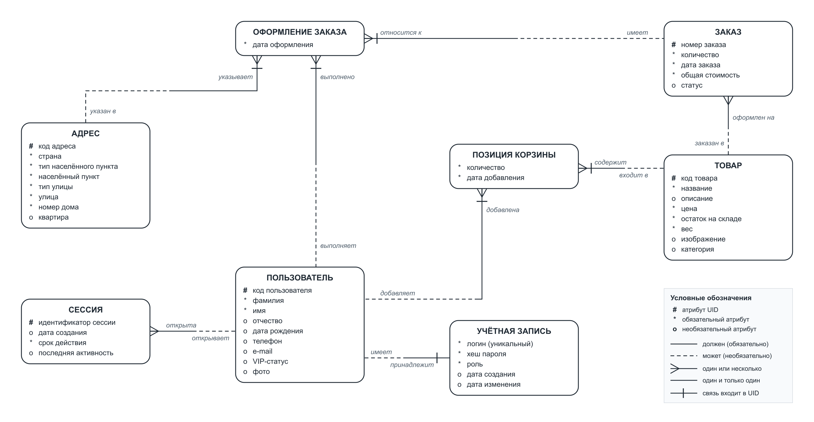
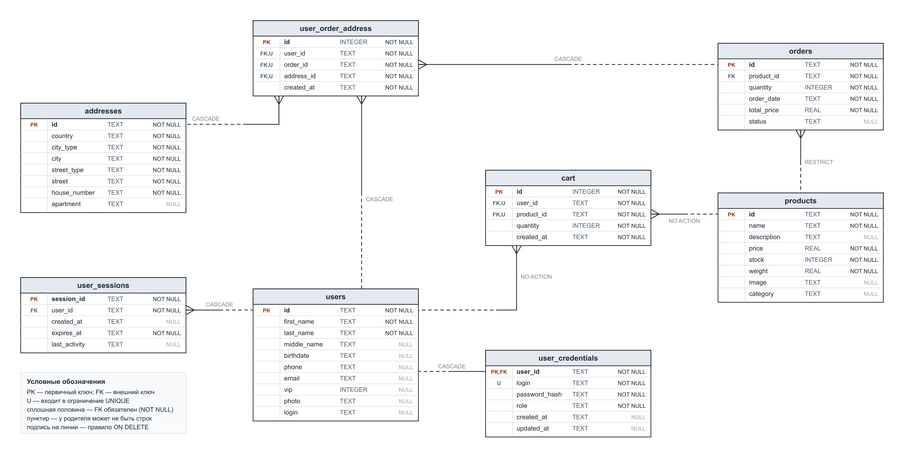

# Модели данных БД `SportPit.db`

## 1. Нотация Баркера

Правила, по которым построена инфологическая диаграмма:

- **Сущность** — прямоугольник со скруглёнными углами, имя в единственном числе ПРОПИСНЫМИ буквами.
- **Атрибуты**: `#` — входит в уникальный идентификатор (UID), `*` — обязательный, `o` — необязательный.
- **Связь** — линия из двух половин, каждая половина описывает участие ближайшей сущности:
  сплошная — «должен», пунктирная — «может».
- **«Воронья лапка»** у сущности — «один или несколько»; простой конец — «один и только один».
- **Имя связи** пишется у той сущности, с которой начинается чтение:
  «Каждый A *должен/может* быть *<имя у A>* *один и только один / один или несколько* B».
- **Черта поперёк связи** у сущности — связь входит в её UID (сущность идентифицируется через родителя).
- **«Dead crows fly east»** («мёртвые вороны летят на восток»): лапки направлены только вверх или влево.
  Детальные сущности («многие», с большим числом экземпляров) стоят выше и левее,
  главные (справочные) — ниже и правее. На диаграмме все лапки висят на нижней или правой
  стороне детальной сущности.
- Связей «многие-ко-многим» нет: ПОЛЬЗОВАТЕЛЬ ⇄ ТОВАР разрешена сущностью-пересечением
  ПОЗИЦИЯ КОРЗИНЫ, тройная связь ПОЛЬЗОВАТЕЛЬ–ЗАКАЗ–АДРЕС — сущностью ОФОРМЛЕНИЕ ЗАКАЗА.
- Суррогатные ключи (`cart.id`, `user_order_address.id`) на инфологическом уровне не показаны:
  естественный UID этих сущностей — комбинация связей (ограничения UNIQUE в БД).

## 2. Инфологическая модель

### Сущности и атрибуты

- **ОФОРМЛЕНИЕ ЗАКАЗА** (`user_order_address`): * дата оформления. UID: ПОЛЬЗОВАТЕЛЬ + ЗАКАЗ + АДРЕС (через связи).
- **ЗАКАЗ** (`orders`): # номер заказа, * количество, * дата заказа, * общая стоимость, o статус. UID: номер заказа.
- **АДРЕС** (`addresses`): # код адреса, * страна, * тип населённого пункта, * населённый пункт, * тип улицы, * улица, * номер дома, o квартира. UID: код адреса.
- **ПОЗИЦИЯ КОРЗИНЫ** (`cart`): * количество, * дата добавления. UID: ПОЛЬЗОВАТЕЛЬ + ТОВАР (через связи).
- **ТОВАР** (`products`): # код товара, * название, o описание, * цена, * остаток на складе, * вес, o изображение, o категория. UID: код товара.
- **ПОЛЬЗОВАТЕЛЬ** (`users`): # код пользователя, * фамилия, * имя, o отчество, o дата рождения, o телефон, o e-mail, o VIP-статус, o фото. UID: код пользователя.
- **СЕССИЯ** (`user_sessions`): # идентификатор сессии, o дата создания, * срок действия, o последняя активность. UID: идентификатор сессии.
- **УЧЁТНАЯ ЗАПИСЬ** (`user_credentials`): * логин (уникальный), * хеш пароля, * роль, o дата создания, o дата изменения. UID: ПОЛЬЗОВАТЕЛЬ (через связь).

### Связи

| Связь | Тип | Чтение от главной сущности | Чтение от подчинённой сущности |
|---|---|---|---|
| ЗАКАЗ — ОФОРМЛЕНИЕ ЗАКАЗА | 1:M | Каждый ЗАКАЗ может иметь одно или несколько ОФОРМЛЕНИЙ ЗАКАЗА | Каждое ОФОРМЛЕНИЕ ЗАКАЗА должно относиться к одному и только одному ЗАКАЗУ |
| АДРЕС — ОФОРМЛЕНИЕ ЗАКАЗА | 1:M | Каждый АДРЕС может быть указан в одном или нескольких ОФОРМЛЕНИЯХ ЗАКАЗА | Каждое ОФОРМЛЕНИЕ ЗАКАЗА должно указывать один и только один АДРЕС |
| ПОЛЬЗОВАТЕЛЬ — ОФОРМЛЕНИЕ ЗАКАЗА | 1:M | Каждый ПОЛЬЗОВАТЕЛЬ может выполнять одно или несколько ОФОРМЛЕНИЙ ЗАКАЗА | Каждое ОФОРМЛЕНИЕ ЗАКАЗА должно быть выполнено одним и только одним ПОЛЬЗОВАТЕЛЕМ |
| ТОВАР — ЗАКАЗ | 1:M | Каждый ТОВАР может быть заказан в одном или нескольких ЗАКАЗАХ | Каждый ЗАКАЗ должен быть оформлен на один и только один ТОВАР |
| ТОВАР — ПОЗИЦИЯ КОРЗИНЫ | 1:M | Каждый ТОВАР может входить в одну или несколько ПОЗИЦИЙ КОРЗИНЫ | Каждая ПОЗИЦИЯ КОРЗИНЫ должна содержать один и только один ТОВАР |
| ПОЛЬЗОВАТЕЛЬ — ПОЗИЦИЯ КОРЗИНЫ | 1:M | Каждый ПОЛЬЗОВАТЕЛЬ может добавлять одну или несколько ПОЗИЦИЙ КОРЗИНЫ | Каждая ПОЗИЦИЯ КОРЗИНЫ должна быть добавлена одним и только одним ПОЛЬЗОВАТЕЛЕМ |
| ПОЛЬЗОВАТЕЛЬ — СЕССИЯ | 1:M | Каждый ПОЛЬЗОВАТЕЛЬ может открывать одну или несколько СЕССИЙ | Каждая СЕССИЯ должна быть открыта одним и только одним ПОЛЬЗОВАТЕЛЕМ |
| ПОЛЬЗОВАТЕЛЬ — УЧЁТНАЯ ЗАПИСЬ | 1:1 | Каждый ПОЛЬЗОВАТЕЛЬ может иметь одну и только одну УЧЁТНУЮ ЗАПИСЬ | Каждая УЧЁТНАЯ ЗАПИСЬ должна принадлежать одному и только одному ПОЛЬЗОВАТЕЛЮ |

## 3. Даталогическая модель

Реляционная модель для СУБД SQLite 3 (типы — классы хранения SQLite: TEXT, INTEGER, REAL; даты хранятся как TEXT в формате ISO-8601).

### Таблица `user_order_address` (строк: 56)

| Поле | Тип | Ключ | NOT NULL | По умолчанию | Ограничения | Описание |
|---|---|---|---|---|---|---|
| `id` | INTEGER | PK | да |  | AUTOINCREMENT | суррогатный ключ |
| `user_id` | TEXT | FK,U | да |  |  | пользователь |
| `order_id` | TEXT | FK,U | да |  |  | заказ |
| `address_id` | TEXT | FK,U | да |  |  | адрес доставки |
| `created_at` | TEXT |  | да |  |  | дата оформления |

- UNIQUE(user_id, order_id, address_id)
- FK `address_id` → `addresses.id`, ON DELETE CASCADE
- FK `order_id` → `orders.id`, ON DELETE CASCADE
- FK `user_id` → `users.id`, ON DELETE CASCADE
- индекс `idx_uo_address_id` (address_id)
- индекс `idx_uo_order_id` (order_id)
- индекс `idx_uo_user_id` (user_id)

### Таблица `orders` (строк: 56)

| Поле | Тип | Ключ | NOT NULL | По умолчанию | Ограничения | Описание |
|---|---|---|---|---|---|---|
| `id` | TEXT | PK | да |  |  | номер заказа |
| `product_id` | TEXT | FK | да |  |  | заказанный товар |
| `quantity` | INTEGER |  | да |  | CHECK(quantity > 0) | количество |
| `order_date` | TEXT |  | да |  |  | дата заказа (ISO-8601) |
| `total_price` | REAL |  | да |  | CHECK(total_price >= 0) | общая стоимость, руб. |
| `status` | TEXT |  | нет | 'pending' |  | pending / processing / shipped / delivered / cancelled |

- FK `product_id` → `products.id`, ON DELETE RESTRICT
- индекс `idx_orders_date` (order_date)
- индекс `idx_orders_product_id` (product_id)

### Таблица `addresses` (строк: 31)

| Поле | Тип | Ключ | NOT NULL | По умолчанию | Ограничения | Описание |
|---|---|---|---|---|---|---|
| `id` | TEXT | PK | да |  |  | код адреса |
| `country` | TEXT |  | да |  |  | страна |
| `city_type` | TEXT |  | да |  |  | тип населённого пункта |
| `city` | TEXT |  | да |  |  | населённый пункт |
| `street_type` | TEXT |  | да |  |  | тип улицы |
| `street` | TEXT |  | да |  |  | улица |
| `house_number` | TEXT |  | да |  |  | номер дома |
| `apartment` | TEXT |  | нет |  |  | квартира |

### Таблица `cart` (строк: 28)

| Поле | Тип | Ключ | NOT NULL | По умолчанию | Ограничения | Описание |
|---|---|---|---|---|---|---|
| `id` | INTEGER | PK | да |  | AUTOINCREMENT | суррогатный ключ |
| `user_id` | TEXT | FK,U | да |  |  | владелец корзины |
| `product_id` | TEXT | FK,U | да |  |  | товар |
| `quantity` | INTEGER |  | да | 1 |  | количество |
| `created_at` | TEXT |  | да |  |  | дата добавления |

- UNIQUE(user_id, product_id)
- FK `product_id` → `products.id`, ON DELETE NO ACTION
- FK `user_id` → `users.id`, ON DELETE NO ACTION

### Таблица `products` (строк: 30)

| Поле | Тип | Ключ | NOT NULL | По умолчанию | Ограничения | Описание |
|---|---|---|---|---|---|---|
| `id` | TEXT | PK | да |  |  | код товара |
| `name` | TEXT |  | да |  |  | название |
| `description` | TEXT |  | нет |  |  | описание |
| `price` | REAL |  | да |  | CHECK (price >= 0) | цена, руб. |
| `stock` | INTEGER |  | да | 0 | CHECK (stock >= 0) | остаток на складе, шт. |
| `weight` | REAL |  | да | 0 | CHECK (weight >= 0) | вес, г |
| `image` | TEXT |  | нет |  |  | путь к изображению |
| `category` | TEXT |  | нет |  |  | категория (ПРОТЕИНЫ, ГЕЙНЕРЫ, …) |

- индекс `idx_products_category` (category)
- индекс `idx_products_name` (name)

### Таблица `users` (строк: 21)

| Поле | Тип | Ключ | NOT NULL | По умолчанию | Ограничения | Описание |
|---|---|---|---|---|---|---|
| `id` | TEXT | PK | да |  |  | код пользователя |
| `first_name` | TEXT |  | да |  |  | имя |
| `last_name` | TEXT |  | да |  |  | фамилия |
| `middle_name` | TEXT |  | нет |  |  | отчество |
| `birthdate` | TEXT |  | нет |  |  | дата рождения (ISO-8601) |
| `phone` | TEXT |  | нет |  |  | телефон |
| `email` | TEXT |  | нет |  |  | электронная почта |
| `vip` | INTEGER |  | нет | 0 |  | VIP-статус (0/1) |
| `photo` | TEXT |  | нет |  |  | путь к фото |
| `login` | TEXT |  | нет |  |  | устаревшее поле, дублирует user_credentials.login |

### Таблица `user_sessions` (строк: 8)

| Поле | Тип | Ключ | NOT NULL | По умолчанию | Ограничения | Описание |
|---|---|---|---|---|---|---|
| `session_id` | TEXT | PK | да |  |  | идентификатор сессии |
| `user_id` | TEXT | FK | да |  |  | владелец сессии |
| `created_at` | TEXT |  | нет | CURRENT_TIMESTAMP |  | дата создания |
| `expires_at` | TEXT |  | да |  |  | срок действия |
| `last_activity` | TEXT |  | нет | CURRENT_TIMESTAMP |  | последняя активность |

- FK `user_id` → `users.id`, ON DELETE CASCADE
- индекс `idx_sessions_expires` (expires_at)
- индекс `idx_sessions_user_id` (user_id)

### Таблица `user_credentials` (строк: 21)

| Поле | Тип | Ключ | NOT NULL | По умолчанию | Ограничения | Описание |
|---|---|---|---|---|---|---|
| `user_id` | TEXT | PK,FK | да |  |  | код пользователя |
| `login` | TEXT | U | да |  |  | логин |
| `password_hash` | TEXT |  | да |  |  | хеш пароля (bcrypt) |
| `role` | TEXT |  | да | 'user' |  | роль: user / admin |
| `created_at` | TEXT |  | нет | CURRENT_TIMESTAMP |  | дата создания |
| `updated_at` | TEXT |  | нет | CURRENT_TIMESTAMP |  | дата изменения |

- UNIQUE(login)
- FK `user_id` → `users.id`, ON DELETE CASCADE
- индекс `idx_credentials_login` (login)

## 4. Замечания по схеме

1. `users.login` — остаток миграции: логин перенесён в `user_credentials.login`, а старое поле
   осталось и дублирует его. В инфологической модели не показано; его стоит удалить.
2. `user_order_address` не запрещает несколько строк на один заказ (нет `UNIQUE(order_id)`),
   хотя по данным каждому заказу соответствует ровно одна строка. Если заказ всегда оформляет
   один пользователь на один адрес, проще хранить `user_id` и `address_id` прямо в `orders`.
3. Приложение не выполняет `PRAGMA foreign_keys = ON`, поэтому SQLite не проверяет внешние ключи
   и не выполняет `ON DELETE CASCADE / RESTRICT`. Сейчас «висячих» ссылок нет
   (`PRAGMA foreign_key_check` пуст), но целостность держится только на коде.
4. У `cart.user_id` и `cart.product_id` не задано `ON DELETE` (по умолчанию NO ACTION).
5. `users.vip`, `orders.status`, поля `created_at` имеют DEFAULT, но допускают NULL.
6. Категория товара — свободный текст; для контроля значений её можно вынести в справочник КАТЕГОРИЯ.
7. Даталогическая схема в отчёте (рис. А2) не совпадает с БД: в ней есть `orders.user_id`,
   `cart.updated_at`, `user_credentials.id`, которых в базе нет, а `orders.product_id` отсутствует.
